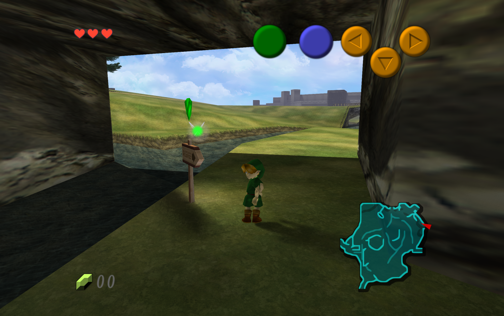
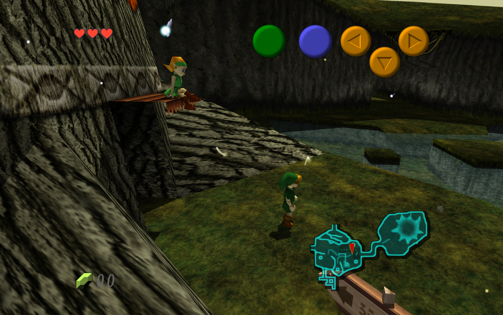
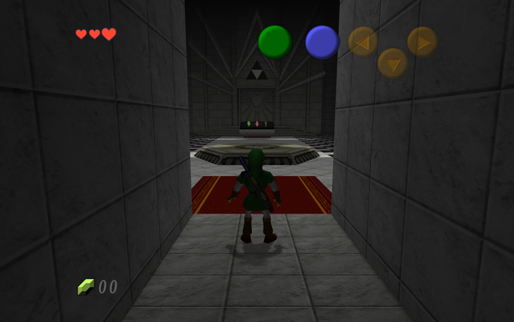

# OoT: Recompiled — macOS gameplay experiment

- Ocarina of Time has been brought to Apple Silicon through Metal, based on [JonB-Dev's OoT: Recompiled 0.6.1](https://github.com/JonB-Dev/oot-recompiled). Ray-traced shadows, local lights, ambient occlusion, widescreen, saves, and replacement textures have been exercised on this Mac.
- The source and experiments have been produced with AI assistance. Original authorship and credits have been retained; this fork is experimental.

## Gameplay captures

- Original 3024×1898 output captures are shown with Full-detail [OoT Reloaded v11.0.0 for RT64](https://github.com/GhostlyDark/OoT-Reloaded/releases/tag/v11.0.0) and level-2 tracing. **Hyrule Field:** 2294×1440 internal render, 4× AA, four AO rays. **Forest and temple:** 3059×1920 internal render, 2× AA, two AO rays. Capture pixels have been preserved through lossless PNG compression; no image enhancement has been applied.
- Texture-pack credit is owed to GhostlyDark and the contributing artists. The pack is obtained separately; it is not bundled here. Capture settings and checksums are recorded with the [benchmark data](docs/benchmarks/2026-11-09-m5.json).

## What is needed to play

- **Tested Mac:** Apple M5 with a 10-core GPU, 32 GiB unified memory, and macOS 26.7.1. A minimum specification has not been established, and compatibility with other Macs has not been qualified.
- **Game:** A personally supplied, unmodified North American NTSC-U 1.0 ROM is required. Other revisions have not been qualified.
- **App:** A locally built macOS app bundle is used; no Mac binary release is currently provided. The one-time native Mac build is covered in the [macOS notes](docs/macos-port.md). Once the app has been built, gameplay does not require the build tools to be run again.
- **Runtime:** SDL2 and FreeType are loaded from the local Homebrew installation by the current app bundle and must remain available.
- **Tracing launch:** The tracing app at `build/rt-compile-probe/OoTRecompiled.app` can be opened normally. In **Graphics**, **Native detail**, **Native balanced**, or **1080p headroom** can be selected; the selected pack is kept at Full detail and level-2 lighting is enabled. Tracing can be switched off in Lighting. No shell variable is needed. `OOT_METAL_RAYTRACING=0` remains an explicit diagnostic opt-out; `--rt-level` is a diagnostic override that takes precedence over the menu.
- **Controls:** Movement is mapped to WASD; A to Space; B to Left Shift; Z-target to Q; Start to Return; C buttons to IJKL. The settings menu is opened with F1. An 8BitDo Ultimate wireless was recognized over Bluetooth with SDL’s built-in mapping. The menu is bound to Back/Select; bindings can be inspected or changed in Controls. Physical button/stick behavior and rumble have not yet been confirmed.
- **Saves and packs:** User data is stored in `~/Library/Application Support/OoT Recompiled/`. An RT64 `.rtz` pack can be placed in its `texture-packs/` folder and selected on the Texture pack row. Existing saves should be backed up before an experimental build is used.

## Visual settings on this M5

- **In-app presets:** Native detail selects native resolution, 4× AA, four AO rays; Native balanced selects native resolution, 2× AA, two AO rays; 1080p headroom selects 1080p, 2× AA, two AO rays. All target the original 20 fps, preserve the selected pack at Full detail, disable downsampling, use original draw distance, and enable shadows/local lights/AO. Level-3 effects are disabled. Changes are saved only when a preset is selected; individual settings remain adjustable. The detected GPU and current output size are displayed alongside the choices. No universal hardware-to-performance guarantee is implied.

- **Steadier-play starting point:** Fullscreen, Resolution **1440p**, aspect **Expand to the window**, Frame rate **Original (20 fps)**, Texture detail **Full**, antialiasing **4×**, four occlusion rays, and the level-2 tracing launch above. Shadows, local lighting, and AO are retained; downsampling is disabled. About 20 presents/s were measured in the heavier child-field trial at these settings.
- **Earlier internal-display measurements:** A sharper internal picture is provided by Resolution **Match the window**, **2×** antialiasing, and **two** AO rays, with roughly 15–20 presents/s across the tested views. Antialiasing can be set to **Off** for additional headroom. A locked 20 fps across the whole game has not been established, and the 60 fps path remains problematic.
- **Session limits:** A 300-second guarded run covered Hyrule Field → Kakariko Village → Temple of Time → Hyrule Field without a detected driver fault; startup and transitions are included in that duration. Native 2×-AA samples were around 16 presents/s in Kakariko and 19–20 in the adult field and temple. Broad game progression, hours-long sessions, and level-3 lighting have not been validated. Isolated test profiles were used; normal saves were preserved.

## Benchmarks on this Mac

- **2026-11-09 · Apple M5, 10 GPU cores · 32 GiB · macOS 26.7.1 · code [`f4917e9`](https://github.com/boscacci/oot-recompiled/commit/f4917e965badd60c3573b6a8cd2b3f4083058e68).** Output was 3024×1898; internal render sizes are listed below. Full-detail textures, level-2 tracing, and the original NTSC 20 fps target were selected in every row.
- The same save and scripted input were used within each scene comparison. Samples cover seconds 69–92. All seven individual runs and the separate scene tour passed the driver-fault and process-memory watchdogs; run durations include startup and file selection.

| Scene | Internal render | AA / AO rays | Mean presents/s | Median interval | Peak process RSS | Run |
| --- | --- | ---: | ---: | ---: | ---: | ---: |
| Kokiri Forest | 3059×1920 | Off / 2 | 19.88 | 50.03 ms | 1310 MiB | 120 s |
| Kokiri Forest | 3059×1920 | 2× / 2 | 19.67 | 50.58 ms | 1328 MiB | 120 s |
| Kokiri Forest | 3059×1920 | Off / 4 | 17.62 | 55.17 ms | 1322 MiB | 120 s |
| Kokiri Forest | 3059×1920 | 8× / 2 | 15.00 | 66.81 ms | 1233 MiB | 120 s |
| Temple of Time | 3059×1920 | 2× / 2 | 20.00 | 49.99 ms | 1144 MiB | 120 s |
| Hyrule Field (child) | 3059×1920 | 2× / 2 | 15.50 | 65.24 ms | 1208 MiB | 110 s |
| Hyrule Field (child) | 2294×1440 | 4× / 4 | 20.00 | 50.00 ms | 1307 MiB | 120 s |

- Timing was measured from actual presentation, rather than the menu's refresh counter. The interval column summarizes one-second means, not individual-frame percentiles. Recording adds overhead; cache, thermal, and power conditions were not controlled across these sequential single runs. The final power check reported battery power with Low Power Mode off. RSS excludes some GPU allocations. Per-second samples and reproduction settings are provided in the [benchmark data](docs/benchmarks/2026-11-09-m5.json).

## Credits and source

- The original OoT: Recompiled project is credited to **Jonathan Barnes**. Its 0.6.1 source at `e5c6edd` was used as the base for this macOS experiment.
- **N64Recomp** and **N64ModernRuntime** are credited to Wiseguy and contributors; **RT64** to its contributors; **Zelda 64: Recompiled** as the reference implementation; and **zeldaret/oot** for the decompilation and symbol information.
- Source is provided under **GPL-3.0**; see [COPYING](COPYING). Dependencies are provided under their own licenses. Game artwork remains credited to Nintendo and texture-pack artwork to its artists. The README screenshots are illustrative; ROMs, texture packs, and generated game code are excluded from the repository.
